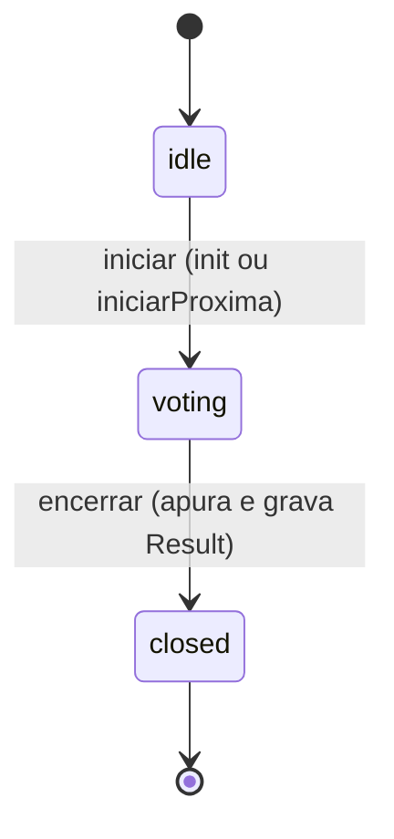
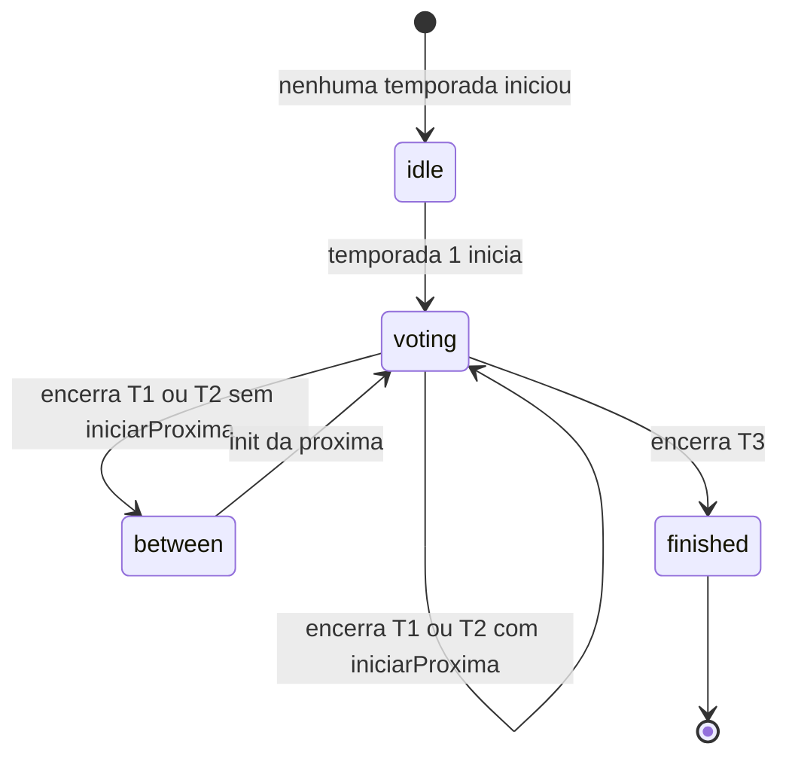

# Encerramento de temporada — pseudocódigo

> Fonte: PROMPT.md §2, §4, §5, §8, §10. Cobre: transação → contagem → veredito →
> gravação de `Result` → fechamento → próxima temporada ou `finished`.
> Pseudocódigo, **não é código final**.

---

## 1. Máquina de estados

### 1.1 Season (uma temporada)



Só avança, nunca volta. Uma temporada `closed` não reabre.

### 1.2 App (estado **derivado**, não gravado)



`finished` **não é coluna do banco**. Ele é calculado (ver §4). Assim não existe
estado duplicado que possa ficar inconsistente com `Season`.

---

## 2. Funções puras (testáveis com Vitest)

```
CONSTANTE TOTAL_SEASONS = 3

/** Regra de veredito (PROMPT §2). Pura: sem banco, sem relógio. */
FUNÇÃO calcularVeredito(forgiveCount, notForgiveCount):
    SE forgiveCount + notForgiveCount == 0:
        RETORNAR "lost"            // zero votos: ninguém decidiu
    SE forgiveCount > notForgiveCount:
        RETORNAR "not_guilty"      // maioria perdoou
    SE notForgiveCount > forgiveCount:
        RETORNAR "guilty"          // maioria não perdoou
    RETORNAR "lost"                // empate: sem maioria, sem veredito


/** Transforma o resultado do groupBy em { [prisonerId]: { forgive, notForgive } }. */
FUNÇÃO montarContagens(votosAgrupados):
    contagens = {}
    PARA CADA linha EM votosAgrupados:       // linha = { prisonerId, choice, _count }
        contagens[linha.prisonerId] ??= { forgive: 0, notForgive: 0 }
        SE linha.choice == "forgive":
            contagens[linha.prisonerId].forgive = linha._count
        SENÃO SE linha.choice == "not_forgive":
            contagens[linha.prisonerId].notForgive = linha._count
        // qualquer outro valor de choice é ignorado (nunca deveria existir, o Zod barra)
    RETORNAR contagens
```

---

## 3. Encerramento — função principal

Chamada por `POST /api/admin/season/closeVoting`.

```
FUNÇÃO encerrarTemporada(numeroTemporada, opcoes, sessao):
    // opcoes = { confirm: boolean, iniciarProxima: boolean (padrão true), novoFim?: data }

    // ── 0. Pré-condições (fora da transação, baratas) ─────────────────
    SE sessao ausente OU sessao.papel != "admin":
        RETORNAR 401/403 { code: "UNAUTHORIZED" }
    SE opcoes.confirm != true:
        RETORNAR 400 { code: "CONFIRMATION_REQUIRED" }
        // a "confirmação dupla" (modal "tem certeza?") também é exigida
        // no servidor: o cliente sozinho não basta
    SE numeroTemporada NÃO ESTÁ ENTRE 1 E TOTAL_SEASONS:
        RETORNAR 400 { code: "INVALID_SEASON" }

    // ── 1. Transação: tudo ou nada ─────────────────────────────────────
    TENTAR:
        saida = await prisma.$transaction(async tx => {

            // 1.1 Compare-and-set: fecha SE E SOMENTE SE ainda estiver "voting".
            //     Dois cliques ou dois admins: só um passa. Também trava a linha
            //     da temporada, o que sincroniza com os votos em andamento (§5).
            fechadas = tx.season.updateMany({
                where: { number: numeroTemporada, status: "voting" },
                data:  { status: "closed", endsAt: agora() }
            })
            SE fechadas.count == 0:
                LANÇAR SEASON_NOT_VOTING        // idle, já fechada ou inexistente

            temporada = tx.season.findUniqueOrThrow({ where: { number: numeroTemporada } })

            // 1.2 Contagem: UMA consulta agrupada, não 10 consultas
            votosAgrupados = tx.vote.groupBy({
                by: ["prisonerId", "choice"],
                where: { seasonId: temporada.id },
                _count: true
            })
            contagens = montarContagens(votosAgrupados)

            // 1.3 Percorrer TODOS os prisioneiros, não só quem recebeu voto.
            //     Quem teve zero votos não aparece no groupBy, e mesmo assim
            //     precisa de um Result ("lost").
            prisioneiros = tx.prisoner.findMany({ select: { id: true } })
            SE prisioneiros.length != 10:
                LANÇAR DATA_INCONSISTENT         // seed quebrado: aborta, nada é gravado

            linhas = []
            PARA CADA p EM prisioneiros:
                c = contagens[p.id] OU { forgive: 0, notForgive: 0 }
                linhas.adicionar({
                    prisonerId:      p.id,
                    seasonId:        temporada.id,
                    forgiveCount:    c.forgive,
                    notForgiveCount: c.notForgive,
                    verdict:         calcularVeredito(c.forgive, c.notForgive)
                })

            // 1.4 Gravar os 10 resultados
            //     @@unique([prisonerId, seasonId]) é a rede de segurança:
            //     se algo tentar apurar duas vezes, o banco recusa.
            tx.result.createMany({ data: linhas })

            // 1.5 Próxima temporada (mesma transação → troca atômica, PROMPT §5)
            proxima = NULO
            SE temporada.number < TOTAL_SEASONS:
                SE opcoes.iniciarProxima == true:
                    iniciadas = tx.season.updateMany({
                        where: { number: temporada.number + 1, status: "idle" },
                        data:  { status: "voting", startsAt: agora(), endsAt: opcoes.novoFim OU NULO }
                    })
                    SE iniciadas.count == 0:
                        LANÇAR NEXT_SEASON_UNAVAILABLE   // ROLLBACK de tudo acima
                    proxima = temporada.number + 1
            // SE temporada.number == TOTAL_SEASONS: não há próxima.
            //    Nada a gravar: "finished" é derivado (§4).

            RETORNAR { fechada: temporada.number, resultados: linhas, proxima }
        })
    CAPTURAR erro:
        SELECIONAR erro.code:
            SEASON_NOT_VOTING:         RETORNAR 409 { code: "SEASON_NOT_VOTING" }
            NEXT_SEASON_UNAVAILABLE:   RETORNAR 409 { code: "NEXT_SEASON_UNAVAILABLE" }
            DATA_INCONSISTENT:         RETORNAR 500 { code: "DATA_INCONSISTENT" }
            QUALQUER OUTRO:            registrarNoSentry(erro); RETORNAR 500 { code: "INTERNAL" }

    // ── 2. Pós-commit (FORA da transação) ─────────────────────────────
    // Só depois do commit as páginas em cache são invalidadas. Isso garante a
    // troca de imagens em TODAS as páginas (critério de aceite do §10).
    revalidatePath("/")
    revalidatePath("/judge")
    revalidatePath("/judge/result/" + saida.fechada)
    revalidatePath("/character")
    revalidatePath("/character/[slug]", "page")

    RETORNAR 200 {
        ok: true,
        fechada: saida.fechada,
        proxima: saida.proxima,                  // número ou null
        appState: calcularEstadoDoApp()          // "voting" | "between" | "finished"
    }
```

### 3.1 Iniciar temporada (`init`)

Usado para a temporada 1 e para retomar depois de uma pausa (`iniciarProxima = false`).

```
FUNÇÃO iniciarTemporada(numeroTemporada, sessao):
    exigir admin + confirm == true

    prisma.$transaction(async tx => {
        SE existe Season com status "voting":
            LANÇAR ANOTHER_SEASON_VOTING            // nunca duas temporadas abertas
        SE numeroTemporada > 1:
            anterior = tx.season.findUnique({ number: numeroTemporada - 1 })
            SE anterior.status != "closed":
                LANÇAR PREVIOUS_NOT_CLOSED          // não pula etapa

        iniciadas = tx.season.updateMany({
            where: { number: numeroTemporada, status: "idle" },
            data:  { status: "voting", startsAt: agora() }
        })
        SE iniciadas.count == 0:
            LANÇAR SEASON_NOT_IDLE
    })
    revalidar páginas (igual ao §3, passo 2)
```

---

## 4. Estado derivado do app (`currentSeason` e `finished`)

```
/** Temporada "atual": define qual imagem cada prisioneiro mostra (PROMPT §5). */
FUNÇÃO getCurrentSeason():
    s = buscar Season com status "voting"
    SE s existe: RETORNAR s

    s = buscar Season com status "closed", ordenar por number desc, primeira
    SE s existe: RETORNAR s            // última encerrada (pausa ou fim)

    RETORNAR buscar Season com number == 1     // tudo ainda "idle"


FUNÇÃO calcularEstadoDoApp():
    SE existe Season com status "voting":
        RETORNAR "voting"
    SE Season número 3 tem status "closed":
        RETORNAR "finished"
    SE existe alguma Season "closed":
        RETORNAR "between"             // pausa entre temporadas
    RETORNAR "idle"
```

Efeitos do estado `finished`:
- `/judge` mostra os cards com o veredito da T3 (`lost` / `not_guilty` / `guilty`) e a faixa
  "Julgamento encerrado". Não abre modal de voto.
- As imagens continuam na temporada 3 (fallback de §5).
- `POST /api/vote` responde `403 SEASON_CLOSED`.
- No `/admin`, "Iniciar" e "Encerrar" ficam desabilitados e o texto explica o motivo.

---

## 5. Concorrência entre voto e encerramento

**Problema:** um voto pode estar em andamento no instante em que o admin encerra.
Só "reconferir `season.status` na transação" (passo 8c de `fluxo-voto.md`) **não basta**
no Postgres com o isolamento padrão (`READ COMMITTED`). O voto lê `voting`, o admin fecha
e conta, e depois o voto grava. Resultado: voto gravado mas **fora da contagem**.

**Solução:** o encerramento já trava a linha da temporada (passo 1.1, o `UPDATE`).
Falta o voto pedir um **lock compartilhado** na mesma linha:

```
// Substitui o passo 8c do fluxo-voto.md
TRANSAÇÃO (voto):
    linhas = SQL cru: SELECT id FROM "Season"
                      WHERE id = season.id AND status = 'voting'
                      FOR SHARE
    SE linhas.length == 0:
        LANÇAR SEASON_CLOSED               // fechou no meio do caminho
    criar Vote { ... }
```

Os dois únicos cenários possíveis:

| Quem chega primeiro | O que acontece |
|---|---|
| **Voto** | Segura o lock; o `UPDATE` do encerramento **espera** o commit do voto; a contagem seguinte **inclui** o voto. |
| **Encerramento** | Segura o lock até o commit; o `FOR SHARE` do voto espera, reavalia a linha, vê `closed` e **recusa** com `SEASON_CLOSED`. |

Nenhum voto fica gravado e ignorado. Em SQLite (dev) as escritas já são serializadas,
então o comportamento é equivalente sem o `FOR SHARE`.

---

## 6. Tabela de respostas

| Status | `code` | Quando |
|---|---|---|
| 200 | — | Encerrada. Corpo traz `fechada`, `proxima` e `appState` |
| 400 | `CONFIRMATION_REQUIRED` | `confirm` ausente ou falso |
| 400 | `INVALID_SEASON` | Número fora de 1 a 3 |
| 401/403 | `UNAUTHORIZED` | Sem sessão admin |
| 409 | `SEASON_NOT_VOTING` | Já encerrada, `idle` ou inexistente (inclui duplo clique) |
| 409 | `NEXT_SEASON_UNAVAILABLE` | Próxima não está `idle`. **Nada foi gravado** (rollback) |
| 500 | `DATA_INCONSISTENT` | Não há exatamente 10 prisioneiros |
| 500 | `INTERNAL` | Erro inesperado (vai para o Sentry) |

---

## 7. Pontos de teste derivados (Etapa 8)

**Vitest (unit):**
- `calcularVeredito`: tabela com `(5,3)` → `not_guilty`, `(3,5)` → `guilty`, `(4,4)` → `lost`,
  `(0,0)` → `lost`, `(1,0)` → `not_guilty`, `(0,1)` → `guilty`.
- `montarContagens`: ignora `choice` desconhecido; prisioneiro sem linha não aparece.
- `getCurrentSeason` e `calcularEstadoDoApp`: um caso por estado (`idle`, `voting`, `between`, `finished`).

**Integração (Vitest + SQLite de teste):**
- Encerrar com **zero votos** → 10 `Result` com `lost`.
- Encerrar duas vezes → 2ª devolve `409 SEASON_NOT_VOTING` e **não duplica** `Result`.
- Encerrar T3 → sem próxima temporada, `appState == "finished"`.
- `NEXT_SEASON_UNAVAILABLE` → rollback: temporada continua `voting`, **0** `Result` gravados.
- Após encerrar T1 com `iniciarProxima`, `getCurrentSeason().number == 2`.

**Playwright (E2E):**
- Admin encerra T1 → `/judge/result/1` mostra % e veredito → `/judge` já exibe imagens da T2.

---

## 8. Decisões em aberto

| # | Ponto | Proposta |
|---|---|---|
| E1 | O §4 lista três ações (`init`, `closeVoting`, `close`) sem definir `close`. | `init` = iniciar; `closeVoting` = esta função inteira (apura + fecha + opcionalmente inicia a próxima). `close` fica **sem uso**; sugiro tirá-la do §4 ou deixá-la como alias de `closeVoting` com `iniciarProxima = false`. |
| E2 | Com `iniciarProxima = true` (seu pedido), a T2 abre no mesmo instante em que a T1 fecha. Então os estados `lost` / `not_guilty` / `guilty` **nunca aparecem nos cards de `/judge`** entre T1→T2 e T2→T3. Só aparecem após a T3, ou em `/judge/result/[n]`. | Manter `iniciarProxima` como **opção do admin**, com padrão `true`. O botão "Encerrar" tem duas variantes: "Encerrar e iniciar próxima" e "Encerrar e aguardar". |
| E3 | `endsAt` da próxima temporada. | `NULO` por padrão (encerramento manual). O fluxo de voto deve tratar `endsAt == NULO` como "sem prazo". Ajustar o passo 5 de `fluxo-voto.md`. |
| E4 | `finished` como estado derivado, não coluna. | Confirmar. Evita estado duplicado e não exige migration. |
| E5 | Apuração exige exatamente 10 prisioneiros (`DATA_INCONSISTENT`). | Confirmar. Falhar alto é melhor que gerar resultado incompleto. |
| E6 | Percentual na página de resultado com `0` votos totais. | Mostrar "Sem votos" e `0% / 0%`, nunca dividir por zero. Detalhar na Etapa 4. |
