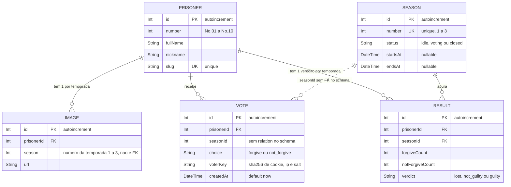

# Diagrama ER — MILGRAM Voting

> Fonte: PROMPT.md §3 (schema Prisma). Este arquivo **documenta** o schema; não o substitui.
> O Mermaid não tem sintaxe para `@@unique` / `@@index`, então eles aparecem
> nos comentários dos campos e na tabela do §3.
> Para gerar o PNG exigido (`docs/diagramas/er.png`): colar o bloco no
> [mermaid.live](https://mermaid.live) e exportar.

---

## 1. Diagrama

Leitura das relações:

| Relação | Cardinalidade | Observação |
|---|---|---|
| Prisoner → Image | 1 : N (máx. 3) | Uma imagem por temporada |
| Prisoner → Vote | 1 : N | Voto sempre aponta para um prisioneiro |
| Prisoner → Result | 1 : N (máx. 3) | Um veredito por temporada |
| Season → Result | 1 : N (máx. 10) | Um resultado por prisioneiro |
| Season ⇢ Vote | 1 : N, **só lógica** | `Vote.seasonId` existe, mas **não há `@relation`** no §3 (ver A1) |

---

## 2. Dicionário de campos

### Prisoner
| Campo | Tipo | Regra |
|---|---|---|
| `id` | Int | PK, autoincrement |
| `number` | Int | 1 a 10 (exibido como "No.01") |
| `fullName` | String | Ex.: 櫻井 遥 |
| `nickname` | String | Ex.: ハルカ |
| `slug` | String | **Único**; usado em `/character/[slug]` |

### Image
| Campo | Tipo | Regra |
|---|---|---|
| `id` | Int | PK |
| `prisonerId` | Int | FK → Prisoner |
| `season` | Int | **Número** da temporada (1 a 3), não o `Season.id` |
| `url` | String | Placeholder até haver upload real |

### Season
| Campo | Tipo | Regra |
|---|---|---|
| `id` | Int | PK |
| `number` | Int | **Único** (1, 2, 3) |
| `status` | String | `idle` → `voting` → `closed` (só avança) |
| `startsAt` | DateTime? | Preenchido ao iniciar |
| `endsAt` | DateTime? | Preenchido ao encerrar |

### Vote
| Campo | Tipo | Regra |
|---|---|---|
| `id` | Int | PK |
| `prisonerId` | Int | FK → Prisoner |
| `seasonId` | Int | Id da temporada em que o voto foi dado |
| `choice` | String | `forgive` ou `not_forgive` (validado por Zod) |
| `voterKey` | String | `sha256(cookie + ip + salt)`; nunca IP puro |
| `createdAt` | DateTime | Base da janela de 24h |

### Result
| Campo | Tipo | Regra |
|---|---|---|
| `id` | Int | PK |
| `prisonerId` | Int | FK → Prisoner |
| `seasonId` | Int | FK → Season |
| `forgiveCount` | Int | Total de votos `forgive` |
| `notForgiveCount` | Int | Total de votos `not_forgive` |
| `verdict` | String | `lost` / `not_guilty` / `guilty` |

---

## 3. Constraints e índices (PROMPT §3)

| Tabela | Declaração | Tipo | Para que serve |
|---|---|---|---|
| Prisoner | `slug @unique` | Único | URL `/character/[slug]` sem ambiguidade |
| Season | `number @unique` | Único | Só existe uma "temporada 2" |
| Image | `@@unique([prisonerId, season])` | Único composto | Garante **1 imagem por prisioneiro por temporada** |
| Result | `@@unique([prisonerId, seasonId])` | Único composto | Garante **1 veredito por prisioneiro por temporada**; protege contra encerramento duplicado |
| Vote | `@@index([prisonerId, seasonId])` | Índice | Contagem de votos no encerramento |
| Vote | `@@index([voterKey, prisonerId, createdAt])` | Índice | Consulta da regra das 24h (`voterKey` + `prisonerId` + `createdAt >= limite`) |

Vote **não tem** `@@unique`. A regra das 24h usa janela móvel, que um índice único não consegue
expressar. Ela é aplicada por consulta + trava (ver `fluxo-voto.md` §3, passo 8).

---

## 4. Domínios dos campos `String`

O schema usa `String` (compatível com SQLite). Os valores válidos são garantidos
por **Zod + union types do TypeScript**, centralizados em `src/types/`:

| Campo | Valores válidos |
|---|---|
| `Season.status` | `"idle"` \| `"voting"` \| `"closed"` |
| `Vote.choice` | `"forgive"` \| `"not_forgive"` |
| `Result.verdict` | `"lost"` \| `"not_guilty"` \| `"guilty"` |

O banco **não** impede um valor inválido, então toda escrita passa pelo Zod.

---

## 5. Pontos de atenção no schema do §3

O PROMPT diz que ele vence qualquer conflito, então **nada abaixo foi alterado**.
São sugestões para você aprovar antes da Etapa 2.

| # | Observação | Sugestão |
|---|---|---|
| A1 | `Vote.seasonId` não tem `@relation` para `Season`. O banco aceitaria votos com temporada inexistente e o Prisma não permitiria `include: { season }` em Vote. | Adicionar `season Season @relation(...)` em Vote e `votes Vote[]` em Season. |
| A2 | `Prisoner.number` não é único. Seria possível ter dois "No.03". | Adicionar `@unique`. |
| A3 | A contagem do encerramento filtra primeiro por `seasonId`, mas o índice começa por `prisonerId`. Com poucos votos não importa; com muitos, vira scan. | Adicionar `@@index([seasonId, prisonerId, choice])`. |

Se aprovar, a mudança vai no `schema.prisma` da Etapa 2 e este diagrama é atualizado.
